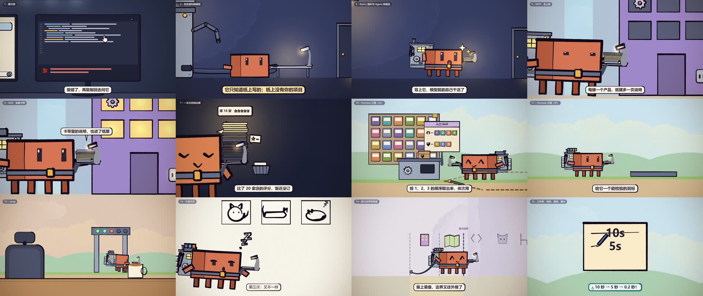

# Agent 往前一步，我们往上一层

一部 10 分 50 秒的手绘风动画，用来代替一场 AI 分享会的 PPT。全片讲三件事：

- AI 是怎么从"只会说话"一步步变成"能独立干完一件事"的；
- 它每往前走一步，我们做了什么、为什么这么做；
- 人的价值到底在哪：活一样样交给 Agent，人跟着能力边界往前走，站到新的位置上。

片子没有旁白，靠画面、短文字气泡和原创配乐讲清楚。现场用法是先完整播一遍，再从头逐章暂停，由讲者讲解。

这部片本身也是论据：每一帧都是 AI 写代码画出来的。

- 画面：p5.js + p5.brush 代码绘制，无头 Chrome 逐帧渲染。墨线略带手绘抖动，色块平涂、不闪。
- 配乐：原创，程序作曲，用 GeneralUser GS 采样音色演奏。音效由乐器跟着画面动作演奏，不用金属音色和合成噪声。
- 片头标题字和封面插画：用 Codex 内置的图像生成单独绘制，提示词随项目附上。



## 成片

[下载完整成片和配乐（v006 Release）](https://github.com/SherlockGy/agent-evolution-film/releases/tag/v006)

- 10 分 49.6 秒，1920×1080，24 fps。
- 视频 H.264（libx264，preset slow，CRF 17），音频 AAC 192 kbps。
- Release 附件：`agent-evolution-film-v006.mp4`（成片）、`agent-evolution-film-v006-music.wav`（配乐）及三张平台封面。

成片约 673 MB，配乐约 115 MB，通过 Release 下载；仓库保留源码、制作文档、素材和封面，无需 Git LFS。

## 封面

`封面/` 下三张 PNG，按平台单独排版，不从视频里截帧：

| 文件 | 尺寸 | 平台与排版要点 |
|---|---|---|
| `封面_B站_16x9.png` | 1920×1080 | B 站；右下角留给时长角标 |
| `封面_小红书_4x3.png` | 1440×1080 | 小红书（横屏视频在信息流里按 4:3 显示） |
| `封面_抖音_9x16.png` | 1080×1920 | 抖音；主要信息放在中间 3:4 区域，避开底部文案区和右侧按钮 |

- 主标题是片头的两行手绘字"Agent 往前一步 / 我们，往上一层"，字号最大。
- 上方一句对观众说的话："AI 越来越能干，你的位置在哪？"只抛问题，不给答案。
- 插画：Clawd 背着机械背包朝观众大步跨出来；上方一只鼠标光标手，把一颗金星按在图纸上。对应片名的两层意思：Agent 往前一步，我们往上一层。
- 插画原图、生成提示词和排版脚本在 `tools/cover/`。

## 章节

时间是成片里的起止时间，每章前有 2.5 秒标题卡。完整的章节时间点见 [`docs/章节时间点.md`](docs/章节时间点.md)，全部文字气泡见 [`docs/气泡文案.md`](docs/气泡文案.md)。

| 章 | 章节名 | 起–止 | 关键词气泡 |
|---|---|---|---|
| 片头 | Agent 往前一步，我们往上一层 | 00:00–00:08 | （两行片名） |
| 1 | 聊天框 | 00:08–00:32 | 它只会「说」；复制、运行，全靠用户自己 |
| 2 | 收发室和那摞纸 | 00:32–01:00 | 整摞一起送来：这就是「上下文」 |
| 3 | 提示词魔法 | 01:00–01:27 | 这就是「提示词工程」：写菜谱扶着它 |
| 4 | ReAct 循环与 Agent 的诞生 | 01:27–02:28 | 想 → 做 → 看，一圈圈循环：「ReAct」；「Agent」= 模型 + 背包（「Harness」） |
| 5 | MCP：走上街 | 02:28–02:56 | 统一的插口：「MCP」 |
| 6 | Skill：技能卡带 | 02:56–03:31 | 打包成卡带：「Skill」 |
| 7 | 一本正经地出错 | 03:31–04:20 | 一本正经地写错：「幻觉」；出错的原因，都在「纸摞」里 |
| 8 | 压缩与子 Agent | 04:20–05:01 | 「压缩」：整摞压成几页摘要；派几个「子 Agent」出去搜 |
| 9 | 上下文工程：管好纸摞里放什么 | 05:01–05:32 | 管好纸摞里放什么：「上下文工程」 |
| 10 | Harness 工程（上）：一个入口，只拿这次要用的工具 | 05:32–06:19 | 为它设计环境：「Harness 工程」 |
| 11 | Harness 工程（下）：像一个靠谱员工那样干活 | 06:19–07:10 | 照靠谱员工的顺序，把流程拉长；给它一个能检验的目标 |
| 12 | Loop：清楚、可核验的目标 | 07:10–07:41 | 做到灯全绿为止：「Loop」 |
| 13 | 不是开关 | 07:41–08:21 | 它是有「智识」的同事，像同事一样相处 |
| 14 | 能力边界和装备 | 08:21–09:05 | 模型一代比一代强：「能力边界」往外扩；按「能力边界」安排它：外面给装备，里面放手 |
| 15 | 许愿 | 09:05–09:36 | 只说想要什么；这部片，就是 AI 写代码画出来的 |
| 16 | 三件事：目标、品味、雄心 | 09:36–10:50 | 「目标」、「品味」、「雄心」；人的价值：跟着边界，「往前走」 |

## 怎么做的

- **制作套件**：在 painted-animation-agent-kit（一个让编码 Agent 制作手绘 2D 动画的套件）的副本上制作，套件的制作指南是 [`ANIMATION_GUIDE.md`](ANIMATION_GUIDE.md)。这部片的内容要求写在 [`docs/目标指南.md`](docs/目标指南.md)，分镜在 [`STORYBOARD.md`](STORYBOARD.md)。
- **按章制作**：`src/config.js` 的 `CHAPTERS` 是唯一的章节表（片头长度是 `INTRO`）。每章有自己的场景文件 `src/scenes/chNN.js`、自己的配乐、自己的视频片段，改一章只重做这一章，最后拼成一片。
- **场景用"本章时间"写**：第 4 到 16 章沿用了第一版的画面，场景文件开头的 `SEG` 表把本章时间映射到第一版的时间，可以带播放速度（放慢、定格）。
- **文字气泡**：全部在 `src/captions.js`，按章写本章时间。
- **配乐**：`music/score.py`，每章一个函数，用本章时间写，和画面的动作点对齐。

## 重新渲染

需要 Node.js、Google Chrome、ffmpeg 和 [uv](https://docs.astral.sh/uv/)（运行 Python 配乐脚本）。Chrome 找不到时用 `--chrome=<路径>` 或环境变量 `CHROME_PATH` 指定。

```bash
npm install

# 配乐：片头和 16 章各一个 wav，输出到 out/music/
uv run music/score.py

# 画面：每章的帧输出到 out/frames/chNN/（可续跑，已渲好的帧会跳过）
node render.mjs --frames --chapter=0,1,2,3,4,5,6,7,8,9,10,11,12,13,14,15,16 --workers=3

# 每章编码成片段（out/chapters/），再拼成一片（{v} 自动取下一个版本号，不覆盖旧版）
node render.mjs --encode --chapter=0,1,2,3,4,5,6,7,8,9,10,11,12,13,14,15,16
node render.mjs --concat "--out=out/成片/启明星分享_{v}.mp4"
```

- 全片约 1.56 万帧。本片制作时在一台 16 GB 内存的 Windows 笔记本（Intel 核显）上，4 个渲染进程平均每帧约 0.6 秒，渲完全片约两个半小时。
- 渲染器带内存保护：系统剩余内存低于 2.5 GB 时暂停，回到 3.5 GB 以上再继续。16 GB 内存的机器建议用 3 个渲染进程，并先关掉 IDE 这类占内存的程序。
- 只想看某一刻的画面：`node render.mjs --stills=秒数 --out=out/stills`（秒数是成片里的时间）。

## 目录

```
README.md                本文件
THIRD_PARTY_NOTICES.md   第三方内容声明
LICENSE                  制作套件沿用的 MIT 许可证
video/                   本地成片和配乐（不纳入 Git，见 Release）
封面/                    三个平台的 PNG 封面（16:9、4:3、9:16）
docs/
  preview.jpg            片中画面拼图
  目标指南.md             这部片要传达什么、画面和镜头语言、每章的要求
  章节时间点.md           每章在成片里的起止时间
  气泡文案.md             全部文字气泡（本章时间和成片时间）
STORYBOARD.md            分镜
ANIMATION_GUIDE.md       制作套件的动画制作指南
CLAUDE.md                给编码 Agent 的工作约定
package.json / package-lock.json   Node 依赖
render.mjs               无头渲染器：检查图、静帧、逐帧、按章编码、拼接
studio.html              渲染用的页面（也可以直接在浏览器里打开预览）
gpu_probe.mjs            检查无头 Chrome 用的是哪块 GPU
src/
  config.js              章节表、片头长度、全片时长
  core.js                绘画引擎：墨线、色块、纸张、文字、镜头
  clawd.js               角色 Clawd 和表情
  props.js / sets.js / shared.js   道具、布景、各章共用的画法
  chapters.js            标题卡、章节切换、章末笔刷收尾
  timeline.js            时间线调度
  sheets.js              角色设定图（studio.html?loop=views / ?loop=emotions 预览）
  captions.js            文字气泡
  scenes/intro.js        片头
  scenes/ch01–ch16.js    16 章场景
music/score.py           全片配乐
assets/
  sf/                    GeneralUser GS 音色库及其许可证
  img/                   片头手绘标题字贴图、第 15 章用到的一张画面
  title_gen/             标题字的生成提示词和原图
tools/cover/             封面插画原图、生成提示词、排版脚本
```
